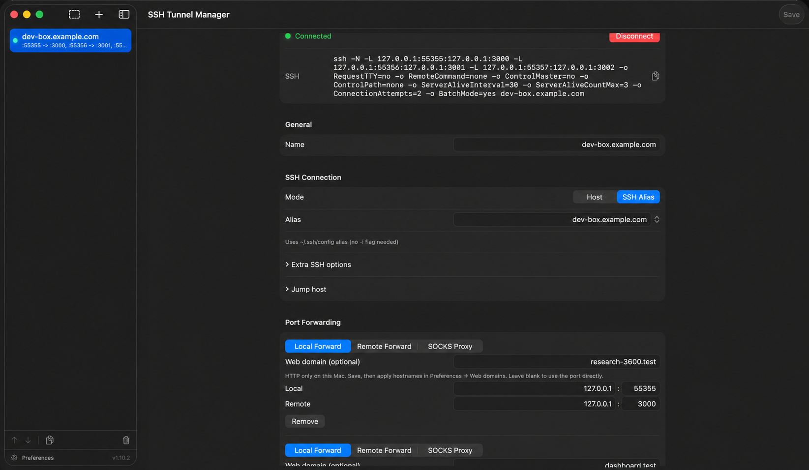

# SSH Tunnel Manager

**English** · [简体中文](README.zh-CN.md)

A native macOS menu bar app for managing SSH port forwards and opening forwarded
web apps with readable local URLs, such as `http://research-3600.test`.

This fork adds [custom HTTP domains](#local-web-domains-http-only) to
[0fuz/ssh-tunnel-manager](https://github.com/0fuz/ssh-tunnel-manager).
[Download the latest build](https://github.com/markul/ssh-tunnel-manager/releases/latest).

<p align="center">
  
</p>
<p align="center">
  
</p>
<p align="center">
  
</p>

## Why?

If you work with remote servers, you constantly need SSH tunnels:
- Database access (`localhost:5432` → production PostgreSQL)
- Internal services (`localhost:8080` → staging API)
- A SOCKS proxy into a private network (`ssh -D`)

Running `ssh -N -L ...` in terminal works, but:
- You forget which tunnels are running
- They die silently when your laptop sleeps
- You need to remember the exact command for each tunnel

This app solves that. Configure once, connect with one click.

## Features

- **Menu bar app** — always accessible, no dock icon clutter
- **Multiple port forwards per tunnel** — one SSH connection, many `-L` / `-R` mappings
- **SOCKS proxy** — per-mapping dynamic forwarding (`ssh -D`), mixable with local forwards
- **Remote forwards** — expose a local service through the server (`ssh -R`) — a self-hosted way out
- **Jump host** — reach a host behind a bastion (`ssh -J`), multi-hop chains included
- **Group tunnels** — organize them with dividers and flip a whole group with one toggle
- **Auto-reconnect** — tunnels automatically reconnect when they drop
- **Failure reasons** — a failed or dropped tunnel shows *why* (auth, refused, unreachable, DNS, host-key change, port in use), not just "disconnected"
- **Connect/disconnect alerts** — optional sound and notification when a tunnel drops or comes back
- **Port-conflict guard** — warns when two tunnels want the same local port and stops them from clobbering each other
- **Per-tunnel tuning** — `ConnectTimeout`, keepalive, compression, "survive brief network drops", host-key options, and a free-text field for any other ssh flags
- **SSH config aliases** — reuse hosts from your `~/.ssh/config`
- **Custom HTTP domains** — assign a `.test` or `.prod` name to each local web forward; use `http://research-3600.test` instead of `http://localhost:55355`
- **Built-in web proxy** — HTTP streaming and WebSockets, with no Caddy installation; HTTP enablement is remembered across launches
- **Launch at login** — start tunnels when your Mac boots
- **Auto-connect** — mark tunnels to connect automatically on app launch
- **Native macOS** — uses system SSH and an integrated HTTP proxy; includes a small port authorization helper

## Alternatives

| App | Issues |
|-----|--------|
| **Core Tunnel** | $10, closed source |
| **Secure Pipes** | Abandoned (last update 2019) |
| **SSH Tunnel Manager (Java)** | Requires JRE, clunky UI |
| **Termius** | Subscription model, overkill for just tunnels |
| **Manual terminal** | No auto-reconnect, easy to forget |

This app is free, open source, and does one thing well.

## Install

### Direct download (this fork)

Download `SSHTunnelManager.dmg` from
[this fork's releases](https://github.com/markul/ssh-tunnel-manager/releases/latest),
open it, and drag the app into **Applications**. Quit the previous app before
replacing it. The universal build supports Apple Silicon and Intel Macs running
macOS 14 or later.

The app is ad-hoc signed, not notarized. If macOS blocks the first launch, use
**System Settings → Privacy & Security → Open Anyway** after attempting to open
it. Only approve a download whose source you trust.

Each release includes `SSHTunnelManager.dmg.sha256`. To check download integrity,
put both files in the same folder and run:

```bash
shasum -a 256 -c SSHTunnelManager.dmg.sha256
```

### Homebrew (upstream)

```bash
brew install --cask 0fuz/tap/ssh-tunnel-manager
```

This command installs from the upstream project's tap, not this fork. Use the
DMG above for this fork's custom HTTP domain build.

## Build from source

```bash
git clone https://github.com/markul/ssh-tunnel-manager.git
cd ssh-tunnel-manager/SSHTunnelManager
xcodebuild -scheme SSHTunnelManager -configuration Release
```

Release builds are tested with Xcode 26.6. The app requires macOS 14 or later.

The integrated HTTP proxy is built from the local `SSHTunnelManager/LocalWebProxy`
Swift package and uses pinned SwiftNIO dependencies. Xcode resolves them on the
first build. No Caddy installation or separate proxy process is needed. To run
the proxy and hostname-management tests independently:

```bash
cd SSHTunnelManager/LocalWebProxy
swift test
```

Third-party licenses and attribution are included in the app's
`ThirdPartyNotices.txt` resource.

## Usage

1. Click the network icon in menu bar
2. Click "Settings" to add tunnels
3. Toggle tunnels on/off from the menu bar

Config is stored in `~/Library/Application Support/SSHTunnelManager/tunnels.json`.

### Local web domains (HTTP only)

Give a forwarded web app a readable address without typing its local port.
For example, if your Mac forwards `127.0.0.1:55355` to an HTTP server at
`127.0.0.1:3000` on a remote development server:

| Before | After assigning a web domain |
| --- | --- |
| `http://localhost:55355` | `http://research-3600.test` |
| `http://localhost:55355/monitoring` | `http://research-3600.test/monitoring` |

The existing localhost URL continues to work. Each local forward can have its
own unique `.test` or `.prod` hostname. No Caddy installation or external DNS service is
needed.

`.prod` is a public domain suffix. A name assigned here overrides that exact
hostname on this Mac while the app's `/etc/hosts` entry exists. Use `.test` if
you want a name reserved for local testing.

<p align="center">
  
</p>

*App screenshot with hostnames, domain names, and ports replaced by example values.*

#### Setup

1. Open the tunnel's settings and find its **Local Forward** mapping. Prefer
   `127.0.0.1` as the local listening address to keep the SSH port private to
   this Mac.
2. Enter `research-3600.test` (or a `.prod` name) in **Web domain (optional)** and save. Enter only
   the hostname: no `http://`, port number, or path.
3. Open **Preferences → Web domains** from the sidebar's gear button. Click
   **Enable HTTP and apply hostnames…** and approve the macOS administrator
   prompt. Later domain edits update the managed hostname entries automatically
   when automatic restoration is enabled. Use **Apply hostnames…** to retry
   after a cancelled prompt.
4. Connect the SSH tunnel and open **http://research-3600.test** in your browser.
   Paths and query strings are forwarded to the web app.

The proxy listens on `127.0.0.1:80` and routes the requested hostname to the
mapping's existing local port. The SSH tunnel still encrypts traffic between
this Mac and the SSH server. The domain feature adds no LAN or public listener;
it does not change the exposure of any separately configured SSH forwards.

#### Restart and administrator authorization

Once HTTP has been enabled, the app remembers that preference and attempts to
restore HTTP on later launches. **This does not remove macOS's administrator
prompt:** authorization may be required again after an app restart, or macOS
may reuse a recent authorization.

A small bundled helper binds an app-created socket only to `127.0.0.1:80`, then
exits. The app retains the socket and processes HTTP; no privileged daemon is
installed. Cancelling authorization leaves HTTP off and does not trigger
repeated prompts during that session. Retry with **Enable HTTP and apply
hostnames…** in Web domains. You can disable **Restore HTTP and apply domain
changes automatically** there.

#### Frontends with a separate backend (CORS)

Changing the frontend URL changes its browser origin. For example, a frontend
at `http://research-3600.test` calling a separately forwarded API at
`http://127.0.0.1:9596` makes cross-origin requests.

- Keep the API's own port forward connected and ensure the frontend's API URL
  points to that reachable endpoint.
- Add the exact frontend origin, **`http://research-3600.test`**, to the backend's
  allowed origins. An origin contains the scheme and hostname, plus a port when
  needed; it does not include `/monitoring` or any other path.
- If the API uses cookies or other credentials, configure its credential and
  preflight handling for that explicit origin. Do not use `*` as a shortcut.

The proxy does not disable browser security or rewrite CORS policies. Services
that validate allowed hostnames, generate absolute URLs, or set cookie domains
may also need their own configuration updated. The proxy preserves the `Host`
header; it does not rewrite HTML, redirects, or cookie domains.

#### Limits and troubleshooting

- **HTTP only:** use an explicit `http://` URL. HTTPS, certificates, public domain
  names, and `.local`/Bonjour names are not supported.
- **Local forwards only:** the mapped SSH listener must accept IPv4 loopback
  connections (`127.0.0.1`, `localhost`, or `0.0.0.0`). Its port cannot be 80;
  that port belongs to the web proxy. Remote and SOCKS forwards cannot have
  web-domain aliases.
- **Port 80 already in use:** Web domains reports the problem. Resolve the
  conflict, then use **Retry proxy**. The app does not stop the other server.
- **HTTP 404:** the requested hostname has no active proxy route. Check the
  spelling, duplicate names, and the saved mapping.
- **HTTP 503:** the route exists, but its SSH tunnel is disconnected or still
  connecting. Connect the tunnel and try again.
- **Streaming:** HTTP/1.1 uses one request per connection. Streaming uploads,
  responses, and WebSocket upgrades are supported; idle streams time out after
  five minutes. Changing a mapping or stopping its tunnel closes existing proxy
  connections.

#### Hostname changes and cleanup

The app updates only its marked block in `/etc/hosts`, preserves unrelated
entries, and rejects conflicting entries. Domain-only edits do not restart SSH;
apply hostname changes separately in **Preferences → Web domains**.

To remove a domain, clear its **Web domain** field, save, then apply hostnames
again. Removing all domains removes the app's managed block. Entries persist
across restarts and are not removed automatically when the app quits or is
uninstalled, so clean them up before uninstalling.

### SOCKS proxy

Set a port mapping's type to **SOCKS** for a dynamic proxy (`ssh -D`). Point your browser, system proxy, or a tool at `127.0.0.1:<port>`. When the tunnel is connected, the detail view's **Usage** section has the address and `socks5h://` / `socks5://` URLs ready to copy.

Use `socks5h://` when DNS should be resolved **on the server** — e.g. to reach internal hostnames behind it; `socks5://` resolves DNS locally:

```bash
curl -x socks5h://127.0.0.1:1080 http://internal-host:8080
```

### Jump host (bastion)

When a host has no public route and is only reachable through a bastion, set the target as the **Host** and the bastion as the **Jump Host** (in the tunnel's *Advanced* section). The app adds `ssh -J`, so the login is routed through the bastion while the forward still targets the final host — the jump host is only a login path, not part of the data flow.

Example — reach a Postgres box `db.internal` that only the bastion can see:

- **Host**: `db.internal`  **Jump Host**: `you@bastion.example.com`
- **Local Forward**: Local `127.0.0.1:5432` → Remote `127.0.0.1:5432`

Then point your client at `localhost:5432`. Chain multiple hops with commas: `you@bastion,you@inner-gateway`.

### Remote forward (expose a local service)

A **Remote Forward** (`ssh -R`) is the reverse of a local forward: the server listens on a port and sends connections back to your Mac — handy for showing a local site to the outside world through a public server, catching a webhook, or reverse SSH. As with the other types, **Local** is always this Mac and **Remote** is the server.

Example — make a local site (`localhost:3000`) reachable at the server's public address:

- **Host**: your public server
- **Remote Forward**: Local `127.0.0.1:3000` → Remote `0.0.0.0:8080`

Now `http://your-server:8080` reaches your Mac's `localhost:3000`. Binding to `0.0.0.0` (rather than the server's own loopback) needs **`GatewayPorts yes`** in the server's `sshd_config`; without it the port is reachable only from the server itself.

### Connection alerts

The app can play a sound and/or show a notification when a tunnel connects or drops unexpectedly. Toggle them in **Preferences** (the gear in the sidebar footer) — sounds are on by default, notifications off. Manual disconnects and config edits stay silent; only genuine drops alert.

Notifications need macOS permission. Turning **Show Notifications** on prompts for it the first time. If notifications still don't appear, open **System Settings → Notifications → SSH Tunnel Manager** and make sure **Allow Notifications** is on — for an unsigned build you may have to enable it there by hand.

### When a tunnel won't connect

A failed or dropped tunnel shows the reason in the menu bar and in its detail view — authentication failed, connection refused, host unreachable, DNS, a changed host key, or a local port already in use — so you know whether to check your key, the server, or your network. The reason sticks until the tunnel reconnects or you stop it. Tunnels that are simply switched off stay grey; red means a real problem.

Two tunnels can't share a local forward port. The settings flag the clash as you type the port, and at connect time the second tunnel reports the port is in use instead of fighting the first — then connects on its own once the port frees.

### Connection options

Each tunnel's detail view exposes a few SSH options for awkward hosts:

- **Connect Timeout / Alive Interval / Alive Count** — how long to wait for the connection, and how aggressively to probe a quiet one before declaring it dead.
- **Compression** (`-C`) — trade CPU for bandwidth on slow links.
- **Survive brief network drops** — keep the tunnel up through short outages (`TCPKeepAlive=no`), relying on the keepalive probes above instead of TCP-level teardown.
- **Skip host key check** — for hosts recreated on the same address. Insecure (disables host-key verification); off by default.
- **Extra SSH options** — a free-text escape hatch for ssh flags the UI doesn't cover, e.g. `-o ConnectTimeout=5`. Appended to the command as-is, split on spaces.
- **Jump Host** (`-J`) — route the login through one or more bastions to reach the host. See [Jump host (bastion)](#jump-host-bastion) above.

## Translations

`README.md` is the source of truth; translations follow it and may lag behind.
Available: [简体中文](README.zh-CN.md). Fixes and sync updates are welcome.

## License

MIT

---

<sub>Built with AI assistance and human review — every change is tested before release.</sub>
